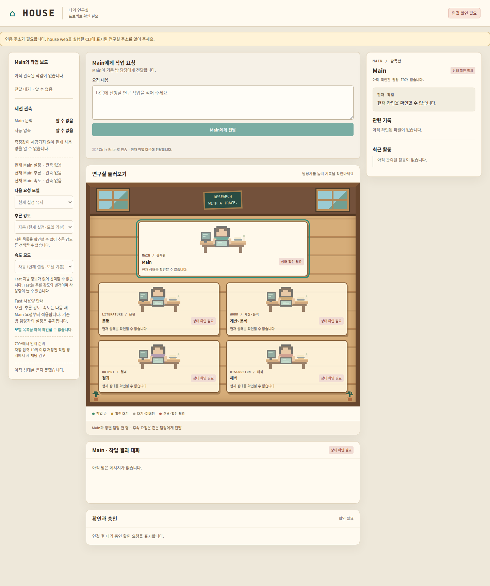

# House

**Codex와 함께 운영하는 연구 작업실.**

연구 작업을 다섯 개의 방으로 나누고, 웹과 터미널에서 대화·진행 상태·결과 파일을 확인하며 다음 대화까지 이어갑니다. House는 로컬에서 실행하며, 기존 연구 프로젝트에 작업 기록과 연구 근거를 연결합니다.

[빠르게 시작하기](#빠르게-시작하기) · [설치·설정](docs/setup.md) · [운영 가이드](docs/operations.md)

## 웹으로 이렇게 사용합니다



*실제 House 웹 원본을 촬영한 서버 미연결 화면입니다. 작업·대화·측정값을 만들어 넣지 않았습니다. [원본 크기로 보기](docs/media/house-web.png) · [캡처 근거](docs/media/house-web.capture.json)*

왼쪽에서 작업 보드와 세션 상태를, 가운데에서 작업 요청·연구실·대화를, 오른쪽에서 선택한 방의 기록을 살펴봅니다. 실제 사용 흐름은 다음과 같습니다.

1. Main에 연구 목표와 다음에 진행할 작업을 전달합니다.
2. Main이 필요한 방의 기존 담당자에게 작업을 연결합니다.
3. 연구실의 담당자를 눌러 대화·현재 작업·관련 파일을 확인합니다.
4. 검토할 질문이나 승인 요청에 응답하고 다음 작업을 이어갑니다.

## House로 할 수 있는 일

| 기능 | 할 수 있는 일 |
| --- | --- |
| 역할별 작업 분담 | 목표 조율, 문헌 탐색, 계산·분석, 결과 정리와 비판적 검토를 담당 방으로 나눕니다. |
| 웹 작업실 | 작업 보드, 방별 대화, 파일, 질문·승인 요청과 세션 관측을 한 화면에서 확인합니다. |
| 연구 입력과 근거 관리 | 합의한 범위, 필수 입력과 당시 기준을 기록해 결과의 근거를 추적합니다. |
| 세션 경고와 인계 | 관측된 문맥 사용량에 따라 인계를 준비하고, 현재 작업과 다음 행동을 저장해 이어갑니다. |
| 기존 프로젝트 연결 | 원래 연구 파일과 프로젝트의 고정 릴리스를 보존하면서 House 기록을 연결합니다. |
| 기록과 데이터 관리 | 텍스트 기록을 추적하고, 선언된 의존성과 보존 정책을 확인해 대량 데이터를 분리합니다. |
| 검토한 스킬 사용 | 외부 스킬 후보를 탐색·검토하고, 프로젝트별로 고정한 구성을 사용합니다. |

## 다섯 개의 방이 함께 일합니다

Main이 연구 목표와 전체 흐름을 정리하고, 각 방은 맡은 역할에 집중합니다. 같은 방의 후속 작업은 기존 담당자에게 전달합니다.

| 방 | 역할 |
| --- | --- |
| **Main** | 연구 이유·목표, 작업 범위와 전체 진행 조율 |
| **Literature** | 문헌 탐색과 근거 정리 |
| **Work** | 합의한 방법의 구현·계산·분석 |
| **Output** | 결과와 산출물 정리 |
| **Discussion** | 해석, 비판적 검토와 개선안 |

실제 구현과 계산은 목표·입력·방법·평가 기준을 합의한 뒤 진행합니다. 자세한 역할과 작업 전달 방식은 [방 지침](skill/references/rooms.md)을 참고하세요.

## 빠르게 시작하기

Git, Python 3.9 이상, 로그인된 Codex CLI가 필요합니다. Python 외부 패키지는 필요하지 않습니다. 아래는 새 설치와 별도 데모 프로젝트를 여는 macOS·Linux·WSL 예시입니다.

```sh
git clone --branch main https://github.com/ISIF-3/house.git "$HOME/house"
cd "$HOME/house"
python3 install.py
export PATH="$HOME/.local/bin:$PATH"

mkdir -p "$HOME/research/house-demo"
house web --project "$HOME/research/house-demo"
```

CLI가 표시한 연구실 주소를 열고, 처음 실행할 때 필요한 훅 검토를 마친 뒤 연구 목표를 정리하며 시작합니다. 명령과 스킬이 설치된 소스 폴더를 사용하므로 설치 뒤 그 폴더를 유지합니다.

<details>
<summary>Windows PowerShell</summary>

```powershell
git clone --branch main https://github.com/ISIF-3/house.git "$HOME\house"
Set-Location "$HOME\house"
py -3 install.py
$env:Path = "$HOME\.local\bin;$env:Path"

New-Item -ItemType Directory -Force "$HOME\research\house-demo" | Out-Null
house web --project "$HOME\research\house-demo"
```

</details>

기존 설치 업데이트, 지속적인 PATH 설정, Windows↔WSL 연결은 [설치·실행·설정 안내](docs/setup.md)를 따릅니다.

## 편한 방식으로 사용하세요

프로젝트 폴더에서 사용할 작업 환경을 선택합니다.

| 작업 환경 | 시작 방법 |
| --- | --- |
| 웹 작업실 | `house web` — 브라우저에서 작업 보드·대화·파일 확인 |
| 터미널 | `house start` — Main 시작. 특정 방은 `house room literature` |
| 기존 Codex 대화 | `$house 연구 목표를 정리하며 시작해줘` — 설치한 스킬로 프로젝트 작업 시작 |

기존 대화의 세션 알림은 `house connect`로 별도 연결하고 훅 허용과 실제 이벤트 수신을 확인합니다. [기존 대화 연결](docs/setup.md#기존-codex-대화에-알림-연결)

## 작업이 길어져도 이어갈 수 있도록

최근 문맥 사용량이 **70% 이상으로 관측되면** 인계를 준비하도록 안내합니다. 목표·확정 결정·진행 중인 작업·다음 행동을 인계 메모에 정리하고 체크포인트로 저장해 다음 대화에서 이어갑니다.

자동 압축 10회 이후에는 인계가 저장된 작업 경계에서 새 대화를 권합니다. 문맥 관측 방식과 인계 저장 명령은 [세션 인계 안내](docs/operations.md#채팅별-작업과-인계)에 있습니다.

## 더 자세히 알아보기

| 문서 | 내용 |
| --- | --- |
| [설치·실행·설정](docs/setup.md) | 환경별 설치, 프로젝트 시작, 연결·경고 확인, 업데이트와 문제 해결 |
| [운영·기록 관리](docs/operations.md) | 저장 구조, 웹 운영, 인계, 데이터 분리, Git 기록과 주간 탐색 |
| [연구 범위와 근거](skill/references/research.md) | 입력, 기준, 실행 근거와 보존 정책 |
| [스킬 업데이트](skill/references/update.md) | 외부 스킬의 탐색·검토·적용과 프로젝트 버전 고정 |
| [검증 기록](docs/verification.md) | 테스트 결과와 실제로 확인한 동작·환경·한계 |
| [변경 이력](CHANGELOG.md) | 버전별 추가·수정 사항 |

macOS·Linux·WSL·native Windows 설치를 지원합니다. 운영 환경별 실제 연결과 경고 화면의 확인 범위는 검증 기록을 참고하세요.
